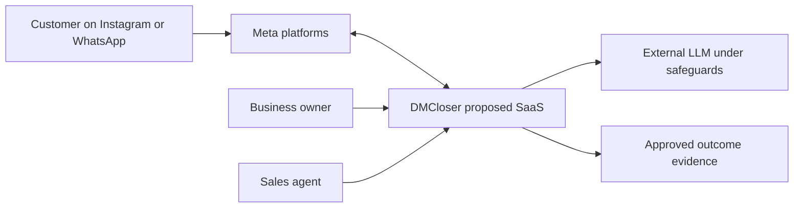

# Product Brief
> Owner: Founder (BRNGT LLC, founder-reported) | Version: 0.5 (working draft) | Updated: 2026-10-20 | Approval: not granted

## Product Overview
**DMCloser 2.0** is a proposed B2B, AI-assisted SaaS web workspace for Instagram and WhatsApp business conversations. **Founder-approved context:** BRNGT LLC is reported to be a Delaware LLC; Saudi Arabia is the first market with globally usable architecture envisioned, all business sectors selectable from day one, Arabic/English, monthly/annual subscription direction, solo founder with AI assistance, extremely low resources. **Current stage:** some UI screens exist; no operational back end, messaging, authentication, data storage or AI feature has been inspected or verified. Preserve useful current UI instead of rebuilding.

## Problem
Customers who contact businesses by DM often wait for answers, repeat details, go unqualified or receive no follow-up. Owners cannot easily connect a conversation to a confirmed revenue outcome, or know the best next action. This is a problem hypothesis until prospective users confirm it.

## Target Customers
Buyer: owner or sales manager of an SMB receiving meaningful inbound Instagram/WhatsApp queries; users: workspace owner and sales operator; external participant: a customer messaging the business. **All-sector accessibility** means configurable fields and knowledge, not clinically, financially or legally regulated expert recommendations. Early interview samples may rotate across property, vehicles, beauty, retail, agencies and administrative clinic booking.

## Value Proposition
A shared inbox plus a grounded AI sales copilot that identifies serious inquiries, recommends safe next steps, keeps human approval for risky practice, and reports potential, attributed and independently evidenced verified revenue separately. Differentiation is a **testable hypothesis**, not proven unique advantage.

## Product Vision
Become a trustworthy conversation-to-revenue assistant whose recommendations and outcomes have inspectable reasons and audit trails rather than opaque automatic replies.

## Business Objectives
- **OBJ-001 / NEED-001:** Improve inquiry handling and priority. Measure first response time, qualified inquiries and abandoned conversations; targets require baseline.
- **OBJ-002 / NEED-002:** Reduce staff follow-up burden without unsafe sends. Measure approvals, handoffs, forbidden-send incidents and saved time in trials.
- **OBJ-003 / NEED-003:** Link meaningful business outcomes to conversations. Measure verified-outcome documentation completeness and disputes.
- **OBJ-004 / NEED-004:** Operate affordable SaaS. Measure cost per workspace, gross contribution and founder operational overhead.

## Product Principles
1. Official channels and least-privilege access. 2. Assist before automating; human send initially. 3. No invented product prices or booking confirmations. 4. Every customer/tenant isolated. 5. Verified revenue needs external proof; estimates are never sales. 6. Usable on mobile with Arabic RTL and English LTR. 7. Flexible sector schema, no special-case code per initial industry.

## Scope Boundaries
P0 prototype-to-functional beta: workspace, login, Inbox, Meta adapter, replies under human control, business knowledge, scoring, translation-ready interface, basic sector configuration, privacy/export safeguards. P1: consent-aware follow-ups, appointments, deal evidence, billing and outcomes; P2: learning and advanced sector playbooks. Excluded: full CRM, additional social channels, bespoke LLM training, autonomous discounts, diagnosis or regulated advice. **Provisional prototype cloud/AI cap: USD 25–50 monthly, not a verified quote or approved recurring liability.**

## Success Criteria
1. A permitted incoming Meta test message appears only in its workspace and can be replied to with a human-approved response. 2. Failed/duplicate webhooks are reconciled without duplicate conversations. 3. Lead classification shows cited signals; unsupported claims are blocked. 4. An outcome cannot be labeled verified without unique evidence. 5. Cross-tenant tests, AI policy regressions and recovery checks pass before customer-data pilots.

## Evidence & Assumptions
**Owner statements:** identity, markets, channels, sector availability, some UI screens, SaaS and solo builder. **Not inspected:** LLC formation, UI repository, hosting accounts, Meta permissions, live costs, interviews, customers or tests. **Assumptions:** enough inbound leads to justify paid use, configurable industry prompts adequate initially, and reliable evidence of closed sales will be obtainable.

## Key Decisions & Risks
**Approved:** all-sector access; preserve existing screens; Saudi-first/global ambition. **Working:** manual-first AI, low-cost TypeScript/PostgreSQL stack after repository audit and legal data-location review; sector presets are configurations. Risks: Meta partner approval, cross-border data, cost overruns, misleading AI/revenue, limited founder capacity. Trade-off: generalized product reach versus focused first marketing test.

## Proposed Product Ecosystem

Related: [PRD](PRD.md), [Business](BUSINESS.md).
