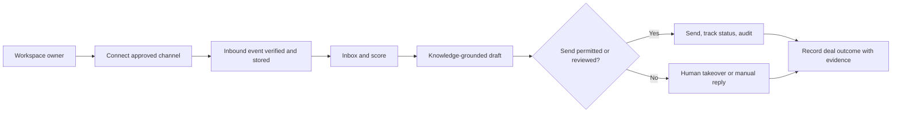

# Product Requirements
> Owner: Founder (BRNGT LLC, founder-reported) | Version: 0.5 (working draft) | Updated: 2026-10-20 | Approval: not granted

## Overview
DMCloser makes business DM conversations actionable and auditable. Foundational context belongs in [BRIEF](BRIEF.md); APIs/stack in [TECH](TECH.md); visual tokens in [DESIGN](DESIGN.md). All feature specifications below are **working requirements not implemented functionality**.

## Evidence & Assumptions
Owner has some UI screens; those screens were not supplied for inspection. No user studies, Meta app access, pricing acceptance or security tests inspected. Success thresholds are trial hypotheses rather than claims.

## Goals
- **G-01 (OBJ-001):** measure qualified inquiries and response delay; choose baseline-relative improvement only after interviews.
- **G-02 (OBJ-002):** demonstrate zero unapproved high-risk outbound messages across blocking validation scenarios.
- **G-03 (OBJ-003):** every amount marked verified has an evidence ID and unique transaction key; no projections in verified total.
- **G-04 (OBJ-004):** track per-customer model use and prevent initiating calls after a configured user budget cap.

## Users & Roles
Owner: manage workspace, connected accounts, knowledge, billing and commercial data; approve responses. Sales operator: read assigned chats, generate drafts, send authorized replies and record lead outcomes, but cannot change system prices or billing. Background worker: limited processing identity. External prospect: Meta participant, not a DMCloser application identity. Every endpoint must authorize workspace membership on the server.

## MVP Scope
**Core vertical slice:** signup → one approved WhatsApp test channel → receive/deduplicate message → inbox → approved business facts → AI or manual draft → human-reviewed send → audit and lead notes. Instagram must be supported by the architecture and activated when Meta permissions are granted, not falsely represented as proven. Simple lead score and recommendation join this slice once the basic message path passes tests. P1 monetization and verification ledger extend the same workflows.

## Non-Goals
No full CRM, outbound bulk campaigns at first release, calendar integration required for core slice, medical diagnosis, model fine-tune, extra channels or assured two-second AI response. Regulated sector fields default off.

## Features
Every card specifies user role, trigger, precondition, positive/negative flow, data and verification pending actual tests. `TEST-NNN` is a **planned** test, not executed evidence.

### FEAT-001 | Business signup and workspace
- **FR-001 / TEST-001 | Priority P0 | Roles:** owner.
- **Purpose:** Deliver business signup and workspace reliably as part of the DMCloser lead-to-revenue flow.
- **Trigger:** signup. **Preconditions:** valid email and terms notice.
- **Main flow:** create named workspace; grant owner.
- **Alternative flow & empty/loading states:** duplicate account returns sign-in; anonymous denied; show progressive loading or retry affordance without fabricating success.
- **Failure paths:** invalid email, rate-limit, email failure; preserve unsent drafts or unfinished changes, log safe diagnostic identifier.
- **Business rules:** one initial owner per workspace. **Inputs:** name, email, hashed auth credentials. **Outputs:** tenant_id and user_id.
- **Permissions:** owner, with server-side tenant authorization. **Dependencies:** AUTH, DB.
- **Acceptance:** Given valid preconditions, the main flow produces `tenant_id and user_id` scoped to the current tenant; given invalid permission/user input or dependency failure, no unauthorized effect occurs and a recoverable error is shown; demonstrated by **TEST-001**, evidence pending.

### FEAT-002 | Inbox and conversation detail
- **FR-002 / TEST-002 | Priority P0 | Roles:** owner, agent.
- **Purpose:** Deliver inbox and conversation detail reliably as part of the DMCloser lead-to-revenue flow.
- **Trigger:** navigation or inbound event. **Preconditions:** authenticated tenant.
- **Main flow:** list and read tenant conversations, status, assignee.
- **Alternative flow & empty/loading states:** empty state teaches connection; unsupported media placeholder; show progressive loading or retry affordance without fabricating success.
- **Failure paths:** inbound API outage, pagination failure; preserve unsent drafts or unfinished changes, log safe diagnostic identifier.
- **Business rules:** no cross-tenant exposure. **Inputs:** channel, message/event metadata. **Outputs:** thread listing.
- **Permissions:** owner/agent, with server-side tenant authorization. **Dependencies:** META, DB.
- **Acceptance:** Given valid preconditions, the main flow produces `thread listing` scoped to the current tenant; given invalid permission/user input or dependency failure, no unauthorized effect occurs and a recoverable error is shown; demonstrated by **TEST-002**, evidence pending.

### FEAT-003 | Meta connection wizard
- **FR-003 / TEST-003 | Priority P0 | Roles:** owner.
- **Purpose:** Deliver meta connection wizard reliably as part of the DMCloser lead-to-revenue flow.
- **Trigger:** connect channel. **Preconditions:** authenticated owner, permitted Meta resources.
- **Main flow:** OAuth/approved connection, status check, capability display.
- **Alternative flow & empty/loading states:** failed connection can retry/remove; show progressive loading or retry affordance without fabricating success.
- **Failure paths:** revoked token, rejected permission; preserve unsent drafts or unfinished changes, log safe diagnostic identifier.
- **Business rules:** official API only; no deceptive status. **Inputs:** channel authorization. **Outputs:** connection and status.
- **Permissions:** owner, with server-side tenant authorization. **Dependencies:** META.
- **Acceptance:** Given valid preconditions, the main flow produces `connection and status` scoped to the current tenant; given invalid permission/user input or dependency failure, no unauthorized effect occurs and a recoverable error is shown; demonstrated by **TEST-003**, evidence pending.

### FEAT-004 | Webhook ingestion
- **FR-004 / TEST-004 | Priority P0 | Roles:** system.
- **Purpose:** Deliver webhook ingestion reliably as part of the DMCloser lead-to-revenue flow.
- **Trigger:** signed incoming event. **Preconditions:** verified origin.
- **Main flow:** deduplicate, persist, queue, ACK.
- **Alternative flow & empty/loading states:** out-of-order event reorders on timestamp; show progressive loading or retry affordance without fabricating success.
- **Failure paths:** signature fail, replay, retry exhaustion; preserve unsent drafts or unfinished changes, log safe diagnostic identifier.
- **Business rules:** idempotent per platform event. **Inputs:** signed webhook JSON. **Outputs:** stored event and message.
- **Permissions:** system, with server-side tenant authorization. **Dependencies:** QUEUE, DB.
- **Acceptance:** Given valid preconditions, the main flow produces `stored event and message` scoped to the current tenant; given invalid permission/user input or dependency failure, no unauthorized effect occurs and a recoverable error is shown; demonstrated by **TEST-004**, evidence pending.

### FEAT-005 | Business Brain
- **FR-005 / TEST-005 | Priority P0 | Roles:** owner.
- **Purpose:** Deliver business brain reliably as part of the DMCloser lead-to-revenue flow.
- **Trigger:** save sources. **Preconditions:** authorized tenant.
- **Main flow:** add FAQs, policy, catalogue, effective price; preview retrieval.
- **Alternative flow & empty/loading states:** save draft without publishing; show progressive loading or retry affordance without fabricating success.
- **Failure paths:** invalid file, absent source, stale price; preserve unsent drafts or unfinished changes, log safe diagnostic identifier.
- **Business rules:** unapproved price never offered. **Inputs:** approved knowledge and version. **Outputs:** retrieval entries and provenance.
- **Permissions:** owner, with server-side tenant authorization. **Dependencies:** DB, AI.
- **Acceptance:** Given valid preconditions, the main flow produces `retrieval entries and provenance` scoped to the current tenant; given invalid permission/user input or dependency failure, no unauthorized effect occurs and a recoverable error is shown; demonstrated by **TEST-005**, evidence pending.

### FEAT-006 | Lead profile and score
- **FR-006 / TEST-006 | Priority P0 | Roles:** owner, agent.
- **Purpose:** Deliver lead profile and score reliably as part of the DMCloser lead-to-revenue flow.
- **Trigger:** new/updated conversation. **Preconditions:** message exists.
- **Main flow:** extract criteria, display reasons and missing fields.
- **Alternative flow & empty/loading states:** manual override with audit; show progressive loading or retry affordance without fabricating success.
- **Failure paths:** insufficient evidence produces unknown, not high score; preserve unsent drafts or unfinished changes, log safe diagnostic identifier.
- **Business rules:** scores never claim sale probability without calibration. **Inputs:** messages, sector fields. **Outputs:** lead status and reason.
- **Permissions:** owner/agent, with server-side tenant authorization. **Dependencies:** AI, DB.
- **Acceptance:** Given valid preconditions, the main flow produces `lead status and reason` scoped to the current tenant; given invalid permission/user input or dependency failure, no unauthorized effect occurs and a recoverable error is shown; demonstrated by **TEST-006**, evidence pending.

### FEAT-007 | AI suggested reply
- **FR-007 / TEST-007 | Priority P0 | Roles:** owner, agent.
- **Purpose:** Deliver ai suggested reply reliably as part of the DMCloser lead-to-revenue flow.
- **Trigger:** draft request. **Preconditions:** approved knowledge available.
- **Main flow:** retrieve approved material, draft, safety check.
- **Alternative flow & empty/loading states:** uncertainty prompts question/handoff; show progressive loading or retry affordance without fabricating success.
- **Failure paths:** provider down means manual textbox; preserve unsent drafts or unfinished changes, log safe diagnostic identifier.
- **Business rules:** never fabricate discount or offer. **Inputs:** messages, approved policy. **Outputs:** draft with citations and flags.
- **Permissions:** owner/agent, with server-side tenant authorization. **Dependencies:** AI.
- **Acceptance:** Given valid preconditions, the main flow produces `draft with citations and flags` scoped to the current tenant; given invalid permission/user input or dependency failure, no unauthorized effect occurs and a recoverable error is shown; demonstrated by **TEST-007**, evidence pending.

### FEAT-008 | Approval and takeover
- **FR-008 / TEST-008 | Priority P0 | Roles:** owner, agent.
- **Purpose:** Deliver approval and takeover reliably as part of the DMCloser lead-to-revenue flow.
- **Trigger:** send or escalate. **Preconditions:** assigned/relevant conversation.
- **Main flow:** approve, edit & send eligible response; pause bot.
- **Alternative flow & empty/loading states:** owner reroutes agent; show progressive loading or retry affordance without fabricating success.
- **Failure paths:** timeout leaves no auto-send; preserve unsent drafts or unfinished changes, log safe diagnostic identifier.
- **Business rules:** high-risk action always human. **Inputs:** draft, permission, channel window. **Outputs:** sent/rejected record.
- **Permissions:** owner/agent, with server-side tenant authorization. **Dependencies:** META, UI.
- **Acceptance:** Given valid preconditions, the main flow produces `sent/rejected record` scoped to the current tenant; given invalid permission/user input or dependency failure, no unauthorized effect occurs and a recoverable error is shown; demonstrated by **TEST-008**, evidence pending.

### FEAT-009 | Next best action
- **FR-009 / TEST-009 | Priority P0 | Roles:** owner, agent.
- **Purpose:** Deliver next best action reliably as part of the DMCloser lead-to-revenue flow.
- **Trigger:** user opens lead. **Preconditions:** lead context.
- **Main flow:** recommend one action with reason and confidence descriptor.
- **Alternative flow & empty/loading states:** unknown info prompts qualification; show progressive loading or retry affordance without fabricating success.
- **Failure paths:** low quality skips recommendation; preserve unsent drafts or unfinished changes, log safe diagnostic identifier.
- **Business rules:** recommendation is not authorization. **Inputs:** score, history, rule. **Outputs:** suggested action.
- **Permissions:** owner/agent, with server-side tenant authorization. **Dependencies:** AI, LEAD.
- **Acceptance:** Given valid preconditions, the main flow produces `suggested action` scoped to the current tenant; given invalid permission/user input or dependency failure, no unauthorized effect occurs and a recoverable error is shown; demonstrated by **TEST-009**, evidence pending.

### FEAT-010 | Search, filters and status
- **FR-010 / TEST-010 | Priority P0 | Roles:** owner, agent.
- **Purpose:** Deliver search, filters and status reliably as part of the DMCloser lead-to-revenue flow.
- **Trigger:** search/filter. **Preconditions:** authenticated user.
- **Main flow:** filter channel, lead status, assignee and time.
- **Alternative flow & empty/loading states:** blank query returns recent; show progressive loading or retry affordance without fabricating success.
- **Failure paths:** server timeout leaves retry state; preserve unsent drafts or unfinished changes, log safe diagnostic identifier.
- **Business rules:** tenant authorizes every result. **Inputs:** filters and query. **Outputs:** paginated list.
- **Permissions:** owner/agent, with server-side tenant authorization. **Dependencies:** DB.
- **Acceptance:** Given valid preconditions, the main flow produces `paginated list` scoped to the current tenant; given invalid permission/user input or dependency failure, no unauthorized effect occurs and a recoverable error is shown; demonstrated by **TEST-010**, evidence pending.

### FEAT-011 | Follow-up scheduler
- **FR-011 / TEST-011 | Priority P1 | Roles:** owner, agent.
- **Purpose:** Deliver follow-up scheduler reliably as part of the DMCloser lead-to-revenue flow.
- **Trigger:** user sets eligible follow-up. **Preconditions:** consent/channel/template validation.
- **Main flow:** schedule, reevaluate eligibility, send if approved.
- **Alternative flow & empty/loading states:** opt-out cancels pending; show progressive loading or retry affordance without fabricating success.
- **Failure paths:** invalid template/window never sends; preserve unsent drafts or unfinished changes, log safe diagnostic identifier.
- **Business rules:** no duplicate and no outside-policy message. **Inputs:** recipient, template, time. **Outputs:** job and outcome.
- **Permissions:** owner/agent, with server-side tenant authorization. **Dependencies:** QUEUE, META.
- **Acceptance:** Given valid preconditions, the main flow produces `job and outcome` scoped to the current tenant; given invalid permission/user input or dependency failure, no unauthorized effect occurs and a recoverable error is shown; demonstrated by **TEST-011**, evidence pending.

### FEAT-012 | Bookings and appointments
- **FR-012 / TEST-012 | Priority P1 | Roles:** owner, agent.
- **Purpose:** Deliver bookings and appointments reliably as part of the DMCloser lead-to-revenue flow.
- **Trigger:** book request. **Preconditions:** availability integration or manual slots.
- **Main flow:** propose slot, confirm and record.
- **Alternative flow & empty/loading states:** conflict prompts alternatives; show progressive loading or retry affordance without fabricating success.
- **Failure paths:** external calendar unavailable => manual handoff; preserve unsent drafts or unfinished changes, log safe diagnostic identifier.
- **Business rules:** never promise unconfirmed slot. **Inputs:** slot, timezone, contact. **Outputs:** booking reference.
- **Permissions:** owner/agent, with server-side tenant authorization. **Dependencies:** CALENDAR.
- **Acceptance:** Given valid preconditions, the main flow produces `booking reference` scoped to the current tenant; given invalid permission/user input or dependency failure, no unauthorized effect occurs and a recoverable error is shown; demonstrated by **TEST-012**, evidence pending.

### FEAT-013 | Deal and outcome ledger
- **FR-013 / TEST-013 | Priority P1 | Roles:** owner, agent.
- **Purpose:** Deliver deal and outcome ledger reliably as part of the DMCloser lead-to-revenue flow.
- **Trigger:** stage or amount change. **Preconditions:** linked contact and evidence.
- **Main flow:** track deal stage, potential/attributed/verified amounts.
- **Alternative flow & empty/loading states:** mark verification disputed or reversed; show progressive loading or retry affordance without fabricating success.
- **Failure paths:** insufficient evidence => unverifiable; preserve unsent drafts or unfinished changes, log safe diagnostic identifier.
- **Business rules:** verified amount needs linked evidence and unique transaction. **Inputs:** deal, corroborating record. **Outputs:** transaction state and provenance.
- **Permissions:** owner, with server-side tenant authorization. **Dependencies:** DB.
- **Acceptance:** Given valid preconditions, the main flow produces `transaction state and provenance` scoped to the current tenant; given invalid permission/user input or dependency failure, no unauthorized effect occurs and a recoverable error is shown; demonstrated by **TEST-013**, evidence pending.

### FEAT-014 | Recovery list
- **FR-014 / TEST-014 | Priority P1 | Roles:** owner, agent.
- **Purpose:** Deliver recovery list reliably as part of the DMCloser lead-to-revenue flow.
- **Trigger:** scheduled scan. **Preconditions:** deal signal and inactivity window.
- **Main flow:** show candidates with reason and next safe action.
- **Alternative flow & empty/loading states:** operator dismisses with reason; show progressive loading or retry affordance without fabricating success.
- **Failure paths:** records lacking consent cannot auto-send; preserve unsent drafts or unfinished changes, log safe diagnostic identifier.
- **Business rules:** estimate lost value separately. **Inputs:** age, stage, rules. **Outputs:** ranked opportunity list.
- **Permissions:** owner/agent, with server-side tenant authorization. **Dependencies:** DEAL.
- **Acceptance:** Given valid preconditions, the main flow produces `ranked opportunity list` scoped to the current tenant; given invalid permission/user input or dependency failure, no unauthorized effect occurs and a recoverable error is shown; demonstrated by **TEST-014**, evidence pending.

### FEAT-015 | Analytics dashboard
- **FR-015 / TEST-015 | Priority P1 | Roles:** owner.
- **Purpose:** Deliver analytics dashboard reliably as part of the DMCloser lead-to-revenue flow.
- **Trigger:** dashboard open. **Preconditions:** events available.
- **Main flow:** show denominator, period, source, confirmed vs estimated revenue.
- **Alternative flow & empty/loading states:** no data yields pointed hints; show progressive loading or retry affordance without fabricating success.
- **Failure paths:** stale or missing data flagged; preserve unsent drafts or unfinished changes, log safe diagnostic identifier.
- **Business rules:** never add estimates to verified totals. **Inputs:** events, outcome ledger. **Outputs:** KPI display.
- **Permissions:** owner, with server-side tenant authorization. **Dependencies:** EVENTS.
- **Acceptance:** Given valid preconditions, the main flow produces `KPI display` scoped to the current tenant; given invalid permission/user input or dependency failure, no unauthorized effect occurs and a recoverable error is shown; demonstrated by **TEST-015**, evidence pending.

### FEAT-016 | Sector configuration
- **FR-016 / TEST-016 | Priority P0 | Roles:** owner.
- **Purpose:** Deliver sector configuration reliably as part of the DMCloser lead-to-revenue flow.
- **Trigger:** workspace setup/change. **Preconditions:** workspace and permissions.
- **Main flow:** choose general profile, optional field presets, questions and policies.
- **Alternative flow & empty/loading states:** custom sector uses generic schema; show progressive loading or retry affordance without fabricating success.
- **Failure paths:** invalid rules rejected; preserve unsent drafts or unfinished changes, log safe diagnostic identifier.
- **Business rules:** all sectors selectable; medical advice disabled. **Inputs:** preset id, field schema. **Outputs:** versioned qualification config.
- **Permissions:** owner, with server-side tenant authorization. **Dependencies:** DB.
- **Acceptance:** Given valid preconditions, the main flow produces `versioned qualification config` scoped to the current tenant; given invalid permission/user input or dependency failure, no unauthorized effect occurs and a recoverable error is shown; demonstrated by **TEST-016**, evidence pending.

### FEAT-017 | AI Quality Lab
- **FR-017 / TEST-017 | Priority P0 | Roles:** owner.
- **Purpose:** Deliver ai quality lab reliably as part of the DMCloser lead-to-revenue flow.
- **Trigger:** update policy or prompt. **Preconditions:** curated deidentified test cases.
- **Main flow:** run fixed scenarios and compare intended/actual behavior.
- **Alternative flow & empty/loading states:** review failed case manually; show progressive loading or retry affordance without fabricating success.
- **Failure paths:** provider unavailable blocks publish; preserve unsent drafts or unfinished changes, log safe diagnostic identifier.
- **Business rules:** unsafe regressions block auto-send. **Inputs:** test dataset, prompt version. **Outputs:** check results.
- **Permissions:** owner, with server-side tenant authorization. **Dependencies:** AI.
- **Acceptance:** Given valid preconditions, the main flow produces `check results` scoped to the current tenant; given invalid permission/user input or dependency failure, no unauthorized effect occurs and a recoverable error is shown; demonstrated by **TEST-017**, evidence pending.

### FEAT-018 | Cost and consent controls
- **FR-018 / TEST-018 | Priority P0 | Roles:** owner.
- **Purpose:** Deliver cost and consent controls reliably as part of the DMCloser lead-to-revenue flow.
- **Trigger:** AI call or outbound action. **Preconditions:** tenant identity.
- **Main flow:** enforce account cap, show costs and consent/optout.
- **Alternative flow & empty/loading states:** switch to manual when cap reached; show progressive loading or retry affordance without fabricating success.
- **Failure paths:** missing consent blocks outbound; preserve unsent drafts or unfinished changes, log safe diagnostic identifier.
- **Business rules:** no silent excess spend. **Inputs:** usage, policy, optout. **Outputs:** ledger and alerts.
- **Permissions:** owner, with server-side tenant authorization. **Dependencies:** BILLING, DB.
- **Acceptance:** Given valid preconditions, the main flow produces `ledger and alerts` scoped to the current tenant; given invalid permission/user input or dependency failure, no unauthorized effect occurs and a recoverable error is shown; demonstrated by **TEST-018**, evidence pending.

### FEAT-019 | Billing and subscription
- **FR-019 / TEST-019 | Priority P1 | Roles:** owner.
- **Purpose:** Deliver billing and subscription reliably as part of the DMCloser lead-to-revenue flow.
- **Trigger:** trial expiry / payment. **Preconditions:** billing provider enabled.
- **Main flow:** request checkout, store provider event, activate entitlement.
- **Alternative flow & empty/loading states:** failed payment read-only grace where configured; show progressive loading or retry affordance without fabricating success.
- **Failure paths:** duplicate webhooks idempotent; preserve unsent drafts or unfinished changes, log safe diagnostic identifier.
- **Business rules:** never store full card numbers. **Inputs:** plan, provider customer and event. **Outputs:** subscription state.
- **Permissions:** owner, with server-side tenant authorization. **Dependencies:** PAYMENTS.
- **Acceptance:** Given valid preconditions, the main flow produces `subscription state` scoped to the current tenant; given invalid permission/user input or dependency failure, no unauthorized effect occurs and a recoverable error is shown; demonstrated by **TEST-019**, evidence pending.

### FEAT-020 | Data export and deletion
- **FR-020 / TEST-020 | Priority P0 | Roles:** owner.
- **Purpose:** Deliver data export and deletion reliably as part of the DMCloser lead-to-revenue flow.
- **Trigger:** request data operation. **Preconditions:** authorized owner and validated scope.
- **Main flow:** export tenant records or initiate policy-governed erasure.
- **Alternative flow & empty/loading states:** legal hold suspends deletion; show progressive loading or retry affordance without fabricating success.
- **Failure paths:** failed job retries, never exposes others; preserve unsent drafts or unfinished changes, log safe diagnostic identifier.
- **Business rules:** retention/hold and audit trail. **Inputs:** tenant and request. **Outputs:** export / deletion receipt.
- **Permissions:** owner, with server-side tenant authorization. **Dependencies:** DB, STORAGE.
- **Acceptance:** Given valid preconditions, the main flow produces `export / deletion receipt` scoped to the current tenant; given invalid permission/user input or dependency failure, no unauthorized effect occurs and a recoverable error is shown; demonstrated by **TEST-020**, evidence pending.

## Critical User Flows

- **Invalid token:** connection status becomes disconnected, prompts reauthorization, does not discard drafts.
- **Network loss:** draft stays locally until safe save; sends require explicit resubmission with idempotency key and server receipt.
- **Double delivery:** repeated event ID maps to one stored event; statuses may update after initial message.
- **Wrong workspace:** always 403/404 with zero data; query filters alone are insufficient.
- **Unsafe AI or indefinite delay:** block auto-send, show evidence and request human action.
- **No source-defined price:** ask for clarification; never invent an offer.
- **Opt-out:** suppress future follow-up, but retain minimally necessary suppression proof as permitted.
- **Sector not preset:** select Custom and define fields/FAQs without modifying application logic.
- **Empty/loading/error UI:** reveal connection/setup CTA, progressive skeleton, explicit retry and non-success delivery state.

## Functional Requirements
Feature card `FR-001` through `FR-020` each states the responsible actors and positive/error behavior. **All are MUST within their stated P0/P1 release gate**, with P1 not a dependency of initial messaging beta. Priority: P0 Must for the safe messaging slice; P1 Should until the revenue product stage is selected. FR-001..FR-020 identifiers correspond exactly to feature numbers. Do not interpret a deferred or P1 feature as shipped.

## Nonfunctional Requirements
- **NFR-001 MUST:** authenticated workspace A cannot access B’s contacts, conversations or tokens across API, jobs and exports; verified by cross-tenant tests.
- **NFR-002 MUST:** repeated signed webhook deliveries store one message per official external message key and update permissible status transitions.
- **NFR-003 MUST:** unknown status cannot display delivered; failed send must show reason and retry state.
- **NFR-004 MUST:** human outbound, AI suggestion and knowledge update persist tenant/actor/time/version audit entries.
- **NFR-005 MUST:** responsive 360px-viewport page has no horizontal screen scrolling in core flows.
- **NFR-006 MUST:** English/Arabic interfaces support LTR/RTL and locale-aware dates; currency symbols/phone numbers remain legible.
- **NFR-007 MUST:** no secrets, raw message bodies or sensitive identifiers in central errors/analytics.
- **NFR-008 MUST:** no new paid AI call begins beyond tenant-configured cost cap; actual vendor settlement may lag and must be monitored.
- **NFR-009 SHOULD:** within tested provider/network conditions, target p95 inbox open <=2s for 100 recent conversations; benchmark conditions and results pending.
- **NFR-010 MUST:** sending rechecks role, opt-out, allowed message window/template, provider state and relevant jurisdiction controls at send time.
- **NFR-011 MUST:** backups restore tenant-safe records and revocation secrets do not unintentionally restore active tokens; recovery targets set before launch.
- **NFR-012 SHOULD:** WCAG 2.2 AA relevant criteria, including keyboard controls, focus visibility, text resizing and contrast; visual direction belongs in [DESIGN](DESIGN.md).

## Acceptance Criteria and Verification
For each FR-NNN: **AC-NNN / TEST-NNN** Given authenticated permitted conditions and valid inputs, when the card's main action occurs, then its defined output is produced once, the correct audit entry exists, and the user gets the correct state; when authorization, validation or dependency fails, no unauthorized external action occurs and retry/handoff is available. This is a test contract, not test evidence.

Additional gate checks:
- **AC-021 / NFR-001:** two workspace fixtures with identical external contact IDs are isolated in lists, details, export, queue, AI retrieval and billing.
- **AC-022 / NFR-002:** replay the same verified event 100 times; result is one logical inbound message.
- **AC-023 / FR-013:** two outcomes with same verified external transaction key never produce double verified revenue; refund creates a reversal, not deleted history.
- **AC-024 / FR-007:** malicious inbound instructions requesting an unapproved discount do not appear in sendable drafts.
- **AC-025 / FR-011,NFR-010:** no follow-up occurs after opt-out, outside permitted windows or under incorrect account permissions.
- **AC-026 / NFR-005,NFR-012:** keyboard-only user can complete connect simulation, search, review and send action; Arabic RTL layout displays without clipping.
- **AC-027 / NFR-008:** exhausted cap blocks next inference and allows a manual response.
Every verification record must contain commit, date, environment, expected/actual, pass/fail and reviewer; all **not executed**.

## Validation
- Hypothesis H1: representative owners have missed high-value conversations; method 12 cross-sector interviews (proposed), metric fraction showing recent real records of missed response and acceptable price, threshold for proceeding to paid test proposed at >= 6 of 12 with evidence.
- H2: founder can create a safe AI workspace without services help; test 5 observed setup pilots, metric completion and material errors, goal >=4/5 without researcher intervention (proposed threshold).
- H3: owner can establish sale evidence without entering a full CRM; test 5 real permitted sales cases, target >=4/5 linked to credible receipt/booking transaction.
These are experimental thresholds, *not observed results*.

## Product Analytics
Track `channel_connect_attempt/success/failure`, `message_ingested`, `draft_displayed/approved/rejected`, `lead_qualified`, `handoff`, `opt_out`, `followup_sent/blocked`, `outcome_claimed/verified/reversed`, `ai_cost_limit`, `tenant_security_denied`; include tenant-scoped event ID, timestamp and source channel, never full message body in analytics. Show denominators for qualified and conversion rates.

## Release Criteria
UI beta: existing assets inspected and tested; one sandbox channel end-to-end; tenancy and permission checks, event idempotency, kill switch, manual review and static security checks pass. Real-data pilot: approved privacy/security basis and vendor contracts/Meta account status established. Paid launch: service and financial gates, duplication-free billing, backup recovery, and legal determination completed by authorized humans.

## Risks & Decisions
Risks: channel approval, impersonation/threats, unreliable sales attribution, cross-border personal data, excessive AI cost. **Working choice:** manual approvals precede autonomous sends; all-sector configuration but selective interview acquisition. [TECH](TECH.md) handles provider feasibility.

## Sources
[Meta WhatsApp webhook guide](https://developers.facebook.com/documentation/business-messaging/whatsapp/webhooks/overview.md/); [Saudi PDPL guidance](https://sdaia.gov.sa/en/Research/Pages/DataProtection.aspx).
