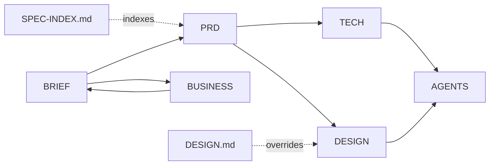

# DMCloser 2.0
> Evidence: **Mixed** — the code is inspected and tested; the external gates are unvalidated
> Delivery: **Working product** (the repository is the inspected source, not a proposal)
> Updated: 2026-10-22

## Overview
DMCloser is a mobile-first sales inbox that converts Instagram/WhatsApp inquiries into qualified opportunities and traceable outcomes through a safe AI sales copilot. It ships in **English and Arabic** with a real RTL layout, supports fixed industry profiles plus a configurable **custom sector**, keeps its prompt under **owner-published version control with a deterministic eval gate**, and separates potential, attributed and verified revenue into three separately labelled blocks.

**Correction to the previous revision of this document.** It stated: *"Owner reports some existing UI screens only, not a functioning MVP."* That was wrong. The repository is a **complete, working, tested product**, and this document set was written against it without inspecting it. The upstream milestone below ("M0 UI repo audit") is **done** — the repository *is* the audited source.

## Product Status — what is actually verified

**Verified by execution** (gate results as of the `feature/bilingual-safety-guards` branch, PR #1):

| Gate | Result |
|---|---|
| `npx tsc --noEmit` | pass |
| `npx tsc -p tsconfig.server.json` | pass |
| `server/tests/product.test.ts` | 30/30 pass |
| `server/tests/revenue.test.ts` | 23/23 pass |
| `server/tests/safety.test.ts` | 11/11 pass |
| `server/tests/quality.test.ts` | 7/7 pass |
| `server/tests/recovery.test.ts` | 5/5 pass |
| `scripts/control-bands.test.mjs` | 2/2 pass |
| `npx playwright test` | 66/66 pass (58 pre-existing + 8 Arabic/RTL) |
| the same 76 server tests on an external Postgres 17 | 76/76 pass |
| compose stack boot, readiness probe, backup and restore rehearsal | pass |
| `npm run build` | pass, 714 kB single-file bundle |
| `npm audit --audit-level=moderate` | 0 vulnerabilities |

76 API/security tests in total. `node scripts/check.mjs` runs every gate above in one command and is the CI entry point.

**Inspected and present:** a full Express 5 + PostgreSQL back end (PGlite on the filesystem for local development); signed webhook ingestion with deduplication; a durable job queue with `FOR UPDATE SKIP LOCKED` leasing and 3-attempt dead-lettering; server-only OpenAI generation with a strict schema and a verbatim grounding gate; encrypted provider tokens at rest; session + CSRF auth with workspace-scoped SQL on every query; a durable outbox with an explicit approval and takeover path; Stripe checkout/portal with idempotent signed events; workspace export and erasure; the full Revenue OS increment (11 tables, 22 routes, 24 service methods); a React 19 client with marketing, isolated demo, and authenticated workspace surfaces; a Playwright + axe accessibility matrix in light and dark mode; a complete English + Arabic interface with a real RTL layout (CSS logical properties, bidi isolation, locale-aware money and dates); bilingual safety guards that detect Arabic opt-outs, injections, secrets, refunds, spam and clinical content; a versioned, owner-published AI prompt with a deterministic evaluation gate that blocks automatic sends; a configurable custom sector on top of the fixed industry profiles; separate Potential / Attributed / Verified revenue blocks; a human recovery worklist; cursor pagination on the conversation list; and `scripts/backup.sh` / `scripts/restore.sh` for the compose stack.

**Still unvalidated — and not verifiable by any local test:** BRNGT LLC incorporation evidence; Meta app approval and channel permissions; live SMTP/OpenAI/Stripe credentials; production Postgres and TLS; cross-border privacy and legal applicability; load-test latency; subscribed customers, real costs, and market demand. Saudi-market-first and globally-planned is **not** worldwide regulatory clearance. The manual-approval requirement and the USD 25–50/mo development spending ceiling remain **provisional recommendations**, not deployed controls or verified quotations.

The compose stack and a backup/restore rehearsal **were** run on a development host — image built, `/api/ready` reported ready, migrations 1–4 applied, registration refused with 503 without SMTP, and a marker row inserted after the backup was gone after the restore. That database was fresh, not production-shaped, and the stack has not been run on the deployment host; the evidence is in `docs/OPERATIONS.md`.

**Known product gaps** (mapped to requirements in the root `SPEC-INDEX.md`): the **assignee filter** is the only one of the ten upstream gaps still open — there is no assignee column in any migration, and conversation assignment is a separate feature that touches the team/roles model, so it is not invented here. Every other gap named by the upstream PRD is now closed: bilingual safety guards, the Arabic/RTL interface, the AI Quality Lab, the custom sector, the three revenue blocks, the recovery list, cursor pagination, and the lead-status filter.

## Documentation
**Shipped and authoritative** (written against the code):
- [Repository instructions and hard rules](../AGENTS.md)
- [Implementation contract](../spec.md)
- [Locked brand and identity](../DESIGN.md)
- [Specification index (FEAT/FR/NFR/AC → status)](../SPEC-INDEX.md)
- [Architecture](ARCHITECTURE.md)
- [API reference](API.md) · [Operations runbook](OPERATIONS.md) · [Revenue OS contract](REVENUE_OS.md) · [Release review](REVIEW.md)

**Upstream proposal** (written before the code was inspected — a gap list, not a description of the product):
- [Product foundation](BRIEF.md)
- [Functional requirements and tests](PRD.md)
- [Architecture and operations](TECH.md)
- [Provisional design tokens](DESIGN.md) — **its colour palette is rejected; the root `DESIGN.md` is normative**
- [Market, finance and governance](BUSINESS.md)

## Documentation Dependencies

## Next Milestone
**M1 is closed.** The Arabic/RTL workspace shipped: the locale context, the logical-property CSS conversion, the Arabic font stack, the language switch, and the Arabic axe matrix. The language switch flips `<html lang dir>`, the Arabic layout has no horizontal overflow at 360 px, money and reference IDs stay LTR-isolated, and the axe matrix passes in Arabic.

**M2 External readiness** — the remaining gates are not engineering tasks inside this repository: Meta app permission evidence, live SMTP/OpenAI/Stripe credentials, production Postgres and TLS, a deployment-host rehearsal of the compose stack, a restore rehearsal against a production-shaped database, a load test, and the cross-border privacy review. Exit: named owner approval of a staging release, with the rehearsal evidence attached.

**M0 UI repo audit: complete.** The repository is the inspected source; the real routes, dependencies, commands and test plan are in `AGENTS.md` and `SPEC-INDEX.md`.

## Critical Gaps
No verified Meta channel access; privacy/legal cross-border role and obligations unresolved; no load test, no restore rehearsal against a production-shaped database, no live credentials; no demand or financing assumptions validated. Thus no real-data pilot, production or global-launch approval — and no claim of a verified latency SLO, backup, or compliance posture.

## External Actions
Founder + qualified counsel → Saudi privacy/marketing/entity review → signed applicability assessment → real-data pilot gate. Founder → Meta app permission evidence and sandbox tests → actual delivery receipts → channel beta gate. Founder → production Postgres/TLS, encryption key, SMTP, OpenAI and Stripe credentials → hosted CI green → staging load/restore/rollback drills → owner release approval. Founder → customer discovery + feature/price evidence → documented results → paid trial decision.

## Maintenance
Founder owns approvals. [BRIEF](BRIEF.md) owns facts; [PRD](PRD.md) tests; [TECH](TECH.md) implementation; [DESIGN](DESIGN.md) tokens; [BUSINESS](BUSINESS.md) commercial and legal. Update linked documents on change, use commit/ADR records and never convert proposals into verified results without attached evidence.
