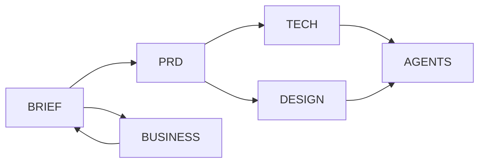

# DMCloser 2.0
> Evidence: **Unvalidated**
> Delivery: **Concept** (specification ready for controlled UI audit and initial implementation planning; full build readiness unverified)
> Updated: 2026-10-20

## Overview
DMCloser is a proposed Arabic/English SaaS that converts Instagram/WhatsApp inquiries into qualified opportunities and traceable outcomes through a safe AI sales copilot. It supports **all sectors** through a configurable industry profile. It separates expected, attributed and verified revenue. Owner reports **some existing UI screens only**, not a functioning MVP.

## Product Status
BRNGT LLC, Delaware is founder-reported; incorporation evidence, source code, Meta permissions, subscribed customers, costs and tests were not inspected. Saudi market first, globally planned; this is not worldwide regulatory clearance. Manual approval for risky messages and a USD 25–50/mo development spending ceiling are **provisional recommendations**, not deployed controls or verified quotations. Validation-ready experiments are specified but market demand is unvalidated.

## Documentation
- [Agent implementation guidance](AGENTS.md)
- [Product foundation](docs/BRIEF.md)
- [Functional requirements and tests](docs/PRD.md)
- [Architecture and operations](docs/TECH.md)
- [Provisional design tokens](docs/DESIGN.md)
- [Market, finance and governance](docs/BUSINESS.md)

## Documentation Dependencies

## Next Milestone
**M0 UI repo audit:** founder shares sanitized screens/source → list real routes, dependencies and commands; compare to proposed architecture and preserve reusable UI. Exit: signed-off inventory and first synthetic end-to-end test plan.

## Critical Gaps
No inspected UI repository; no verified Meta channel access; privacy/legal cross-border role and obligations unresolved; no actual tenant/AI/security tests; no demand or financing assumptions validated. Thus no real-data pilot, production or global-launch approval.

## External Actions
Founder → supply sanitized source/manifest → inspected routes and runnable commands → approved implementation plan. Founder + qualified counsel → Saudi privacy/marketing/entity review → signed applicability assessment → real-data pilot gate. Founder → Meta app permission evidence and sandbox tests → actual delivery receipts → channel beta gate. Founder → customer discovery + feature/price evidence → documented results → paid trial decision.

## Maintenance
Founder owns approvals. [BRIEF](docs/BRIEF.md) owns facts; [PRD](docs/PRD.md) tests; [TECH](docs/TECH.md) implementation; [DESIGN](docs/DESIGN.md) tokens; [BUSINESS](docs/BUSINESS.md) commercial and legal. Update linked documents on change, use commit/ADR records and never convert proposals into verified results without attached evidence.
