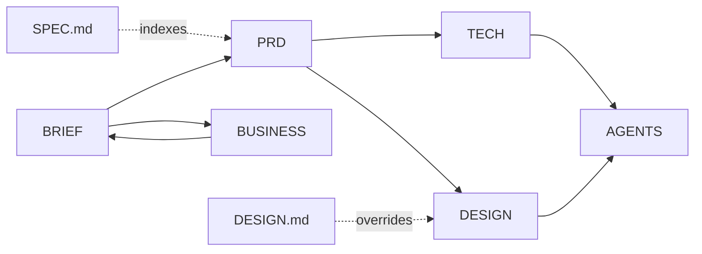

# DMCloser 2.0
> Evidence: **Mixed** — the code is inspected and tested; the external gates are unvalidated
> Delivery: **Working product** (the repository is the inspected source, not a proposal)
> Updated: 2026-10-21

## Overview
DMCloser is a mobile-first sales inbox that converts Instagram/WhatsApp inquiries into qualified opportunities and traceable outcomes through a safe AI sales copilot. It supports **five fixed industry profiles** today, with a configurable custom sector specced but not yet built. It separates expected, attributed and verified revenue.

**Correction to the previous revision of this document.** It stated: *"Owner reports some existing UI screens only, not a functioning MVP."* That was wrong. The repository is a **complete, working, tested product**, and this document set was written against it without inspecting it. The upstream milestone below ("M0 UI repo audit") is **done** — the repository *is* the audited source.

## Product Status — what is actually verified

**Verified by execution** (gate results as of commit `2f500e9`):

| Gate | Result |
|---|---|
| `npx tsc --noEmit` | pass |
| `npx tsc -p tsconfig.server.json` | pass |
| `server/tests/product.test.ts` | 28/28 pass |
| `server/tests/revenue.test.ts` | 21/21 pass |
| `scripts/control-bands.test.mjs` | 2/2 pass |
| `npx playwright test` | 58/58 pass |
| `npm run build` | pass, 568 kB single-file bundle |
| `npm audit --audit-level=moderate` | 0 vulnerabilities |

**Inspected and present:** a full Express 5 + PostgreSQL back end (PGlite on the filesystem for local development); signed webhook ingestion with deduplication; a durable job queue with `FOR UPDATE SKIP LOCKED` leasing and 3-attempt dead-lettering; server-only OpenAI generation with a strict schema and a verbatim grounding gate; encrypted provider tokens at rest; session + CSRF auth with workspace-scoped SQL on every query; a durable outbox with an explicit approval and takeover path; Stripe checkout/portal with idempotent signed events; workspace export and erasure; the full Revenue OS increment (11 tables, 22 routes, 24 service methods); a React 19 client with marketing, isolated demo, and authenticated workspace surfaces; a Playwright + axe accessibility matrix in light and dark mode.

**Still unvalidated — and not verifiable by any local test:** BRNGT LLC incorporation evidence; Meta app approval and channel permissions; live SMTP/OpenAI/Stripe credentials; production Postgres and TLS; cross-border privacy and legal applicability; load-test latency; backup and restore rehearsal; subscribed customers, real costs, and market demand. Saudi-market-first and globally-planned is **not** worldwide regulatory clearance. The manual-approval requirement and the USD 25–50/mo development spending ceiling remain **provisional recommendations**, not deployed controls or verified quotations.

**Known product gaps** (mapped to requirements in the root `SPEC.md`): the Arabic/RTL interface (NFR-006) is not built — the server-side safety guards are bilingual, the UI is English-only; the AI Quality Lab (FEAT-017) does not exist; the industry profile is a closed six-value constraint rather than "all sectors"; revenue totals are not yet split into separately labelled Potential / Attributed / Verified blocks; there is no cursor pagination and no lead-status or assignee filter.

## Documentation
**Shipped and authoritative** (written against the code):
- [Repository instructions and hard rules](../AGENTS.md)
- [Implementation contract](../spec.md)
- [Locked brand and identity](../DESIGN.md)
- [Specification index (FEAT/FR/NFR/AC → status)](../SPEC.md)
- [Architecture](ARCHITECTURE.md)
- [API reference](API.md) · [Operations runbook](OPERATIONS.md) · [Revenue OS contract](REVENUE_OS.md) · [Release review](REVIEW.md)

**Upstream proposal** (written before the code was inspected — a gap list, not a description of the product):
- [Product foundation](BRIEF.md)
- [Functional requirements and tests](PRD.md)
- [Architecture and operations](TECH.md)
- [Provisional design tokens](DESIGN.md) — **its colour palette is rejected; the root `DESIGN.md` is normative**
- [Market, finance and governance](BUSINESS.md)

## Documentation Dependencies

## Next Milestone
**M1 Arabic/RTL workspace** — the one upstream MUST that is still open (NFR-006, AC-026). The server-side safety guards are already bilingual; the interface, the locale context, the logical-property CSS conversion, and the Arabic font stack are not. Exit: the language switch flips `<html lang dir>`, the Arabic layout has no horizontal overflow at 360 px, money and reference IDs stay LTR-isolated, and the axe matrix passes in Arabic.

**M0 UI repo audit: complete.** The repository is the inspected source; the real routes, dependencies, commands and test plan are in `AGENTS.md` and `SPEC.md`.

## Critical Gaps
No verified Meta channel access; privacy/legal cross-border role and obligations unresolved; no load test, no restore rehearsal, no live credentials; no demand or financing assumptions validated. Thus no real-data pilot, production or global-launch approval — and no claim of a verified latency SLO, backup, or compliance posture.

## External Actions
Founder + qualified counsel → Saudi privacy/marketing/entity review → signed applicability assessment → real-data pilot gate. Founder → Meta app permission evidence and sandbox tests → actual delivery receipts → channel beta gate. Founder → production Postgres/TLS, encryption key, SMTP, OpenAI and Stripe credentials → hosted CI green → staging load/restore/rollback drills → owner release approval. Founder → customer discovery + feature/price evidence → documented results → paid trial decision.

## Maintenance
Founder owns approvals. [BRIEF](BRIEF.md) owns facts; [PRD](PRD.md) tests; [TECH](TECH.md) implementation; [DESIGN](DESIGN.md) tokens; [BUSINESS](BUSINESS.md) commercial and legal. Update linked documents on change, use commit/ADR records and never convert proposals into verified results without attached evidence.
