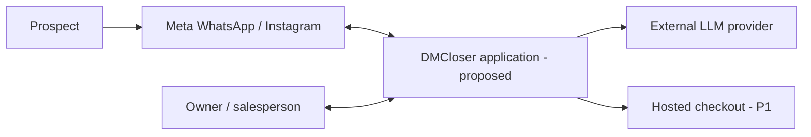
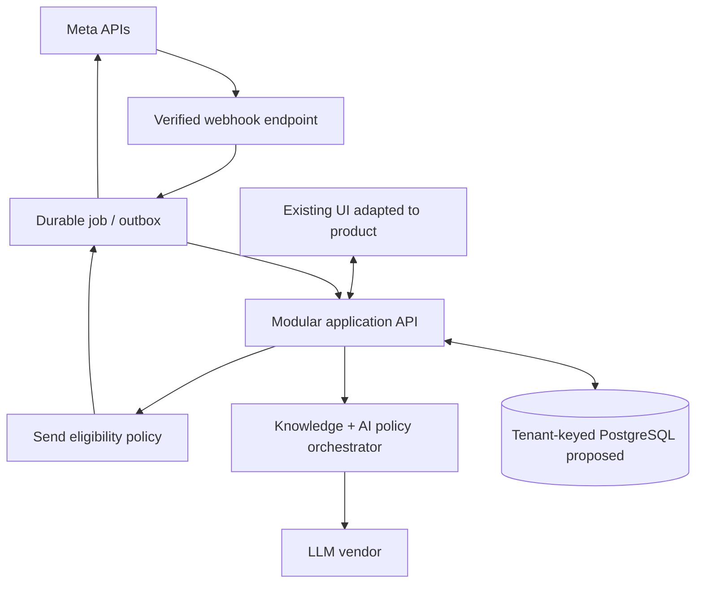
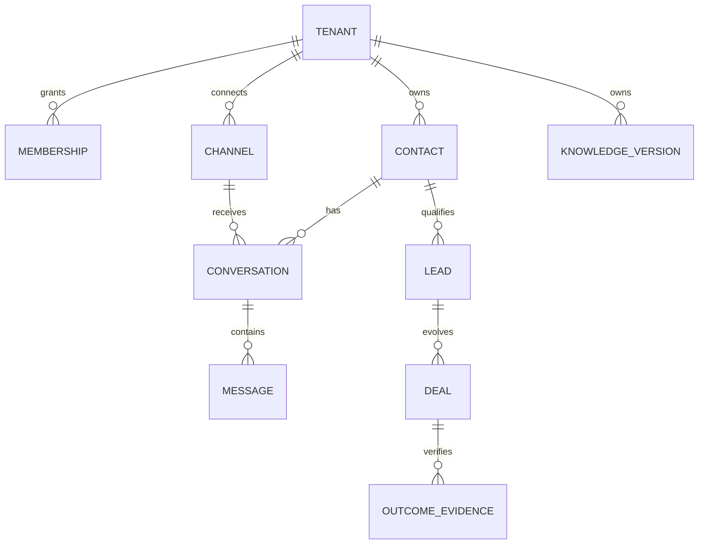
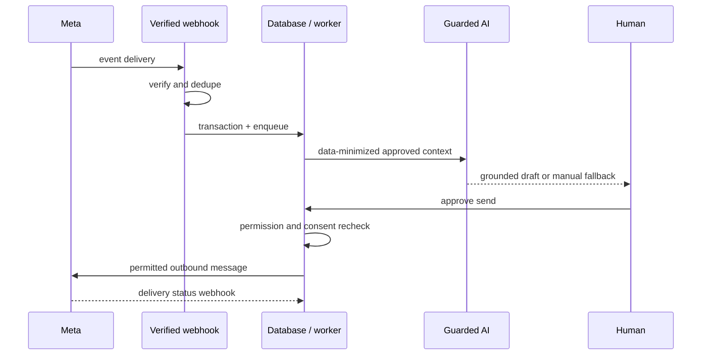

# Technical Design
> Owner: Founder (BRNGT LLC, founder-reported) | Version: 0.5 (working draft) | Updated: 2026-10-20 | Approval: not granted

## Context & Constraints
Implementation is **proposed**, not installed or deployed. The owner reports some UI screens only; inspect the project before choosing a frontend framework or executing commands. Initial cost guardrail of USD 25–50/month is provisional for synthetic development, excluding taxes, contractor, company maintenance and Meta bulk messaging. Requirements [PRD](PRD.md) FR-001..020 and NFR-001..012 control design. Hosting country requires privacy assessment before sending Saudi personal data.

## Architecture
Style: modular monolith with asynchronous webhook/job processing, few vendor dependencies and a single relational database for early scale. Separate logical trust zones: external Meta/billing webhooks, authenticated tenant APIs, AI provider and private storage; keep future scaling possible without services-by-default.

### Proposed C4-level system context

### Proposed container relationships

## Technology Stack
| Layer | Working choice | Status | Why / alternative |
|---|---|---|---|
| Frontend | retain existing UI framework; React/Next.js only if replacement unavoidable | Provisional | protects work; repo audit required |
| Backend | TypeScript HTTP application supporting modular routes | Provisional | one language; FastAPI acceptable if UI repo already Python |
| Data | managed PostgreSQL with membership checks and optional row-level security | Provisional | transactional deal and message audit; verify hosting location |
| Async | DB outbox and retry worker | Provisional | no Redis bill initially; dedicated queue if volume requires |
| Auth | managed hosted authentication plus server-side workspace membership | Provisional | avoid homegrown password reset machinery |
| Cloud | smallest server runtime capable of signed webhooks + durable jobs | Provisional | cheapest permitted location and manageable backups; provider approval required |
| LLM | low-cost model accessed via adapter with strict cost cap | Provisional | flexible provider switching, no hardcoded model promises |
| Payment | eligible hosted checkout, provider events only | Provisional P1 | avoid card handling; availability check required |

## Components
| Component | Inputs | Outputs | Boundary and failure handling |
|---|---|---|---|
| UI | session, conversation APIs | localized pages & user actions | no secrets; network retry; never fakes delivery |
| Identity | token/session, workspace | principal and role | reject missing tenant authorization |
| Channel adapter | verified Meta webhooks, outbound intent | normalized events, delivery receipts | version adapter, retry/backoff, disconnected state |
| Queue & outbox | durable event payload | asynchronously processed tasks | event dedupe, poison queue, replay tooling |
| Knowledge | approved FAQs/products/prices | versioned normalized references | reject unapproved sources and expired price |
| AI orchestrator | tenant-scoped context, policy, cost | structured suggestion + provenance | timeout, schema validation, human fallback |
| Send policy | principal, consent, template/window, draft | eligible or denied send | deny by default + audit reason |
| Deal ledger | deal/outcome/evidence reference | potential, attributed, verified totals | unique transaction key + reversal events |
| Usage & billing | inference/cost events, provider statuses | entitlements and quota decisions | updates idempotent; cards held only at processor |

## Data Architecture
Every tenant-owned table carries `tenant_id` and server-calculated access scope. Entities: `tenant`, `membership`, `channel`, `contact`, `conversation`, `message`, `event_inbox`, `outbox`, `lead`, `knowledge_version`, `sector_profile`, `deal`, `outcome_evidence`, `audit_event`, `consent_record`, `usage_event`, `subscription`. Proposed keys: `(channel_id, external_message_id)` unique; `(tenant_id, verified_source, transaction_id)` unique on evidence. Contact identifiers pseudonymized where practical; phone/contact handle and texts personal; channel secrets highly restricted; verified deal amounts sensitive business data.

**Lifecycle:** collect only channel data and essential qualification fields, version approved knowledge, archive/export per tenant, erase upon valid request and lawful hold check, propagate deletion to providers/backups per validated schedule. Retention periods cannot be guessed; authorized privacy review required. Backup encryption, separate credential store, daily automated backups where offered, tested restore and per-tenant audit pagination before pilot. Availability targets and RPO/RTO must be negotiated from actual vendor capability and customer dependence.

## APIs & Integrations
Server endpoints are suggested contracts, not actual running routes. Version URLs `/v1/tenants/{tenantId}/conversations` GET (cursor pagination), `/v1/conversations/{id}/messages` GET, `/v1/conversations/{id}/drafts` POST (non-send), `/v1/conversations/{id}/send` POST (idempotency and eligibility), `/v1/leads/{id}/score` POST, `/v1/deals/{id}/outcomes` POST, `/v1/tenants/{id}/knowledge` POST, `/webhooks/meta` POST, `/webhooks/billing` POST. External webhooks authenticated by their provider-specific verification mechanisms; internal APIs require short-lived session credential. Incoming JSON validated schema/size/content-type, consistent `{error:{code,message,request_id}}`; retry `429`/5xx with exponential backoff and dead-letter, no blind replay of non-idempotent sends. Establish request timeout, provider rate-limit backpressure and Graph API version upgrade testing per changelog.

**Meta implementation dependency:** official WhatsApp uses platform webhooks and specific permission scopes; provider confirms subscription and production access, and external business onboarding may require App Review/advanced access. Instagram onboarding is **separate** and must be verified with its own official permissions and account types. Do not infer Instagram functionality from WhatsApp sandbox. Sources: [webhooks](https://developers.facebook.com/documentation/business-messaging/whatsapp/webhooks/overview.md/), [message sending](https://developers.facebook.com/documentation/business-messaging/whatsapp/reference/whatsapp-business-phone-number/message-api/).

## Identity & Access
Workspaces own channel connectors. Owner can administer connections, knowledge, company price list, users, outcomes and billing. Agent can work delegated conversations and suggest outcomes but not manipulate pricing settings. Guard every job, query, export, AI retrieval and signed upload by server-owned tenant context (NFR-001). CSRF protection for browser sessions; secure httpOnly cookies when applicable; brute-force/login throttling; choose/respect provider MFA capabilities. Revocation on disconnect and user departure.

## Security & Privacy
Major threats: cross-tenant read/write, forged webhooks, stolen Meta tokens, prompt injection, unauthorized outbound marketing, fabricated revenue, PII in logs and derivative AI storage. Controls include schema validation, raw-body signature checks, rotating vault secrets, least-privilege auth, safe HTML escaping, security headers, content minimization, outbound tool allowlist and explicit human approval gates. Zero high-risk auto-send before tests. Apply context-appropriate OWASP ASVS guidance voluntarily, not claimed certification. Incident flow: stop sending → isolate account → preserve relevant logs → counsel/privacy notification assessment → repair → recovery drill → postmortem.

## AI Architecture
**Model/provider unknown until vendor selection.** A model adapter yields documented structured fields (`intent`, `missing_fields`, `draft`, `source_refs`, `risk_flags`, `suggested_action`) from tenant-scoped messages and approved knowledge. Place raw user text strictly as input, never operating directives. Retrieval version and approved effective prices visible to reviewer. Tools cannot directly charge, discount or change subscriptions. Output schema and deterministic price/template checks run before human display and second eligibility checks before sending. Version prompt/knowledge/model; test Arabic+English, mixed prompt injections, pricing, hallucinations, non-existent items, safe refusal, opt-out and inconsistent outcomes. Evaluate against genuine curated/deidentified examples (not yet gathered). Timeout/model failure → manual reply; cost-cap exceeded → skip; unknown confidence → don't auto-send. No customer data fine-tuning across tenants.

## Quality Attributes
Prototype proposals: idempotent webhooks (100 identical deliveries -> one message); p95 inbox screen <=2s under named tested fixture/provider conditions; 360px UI minimum; 100% tenancy/security critical test pass before live customer data; cost cap enforcement at request admission (outside vendor late-settlement possible); reported provider delivery states cannot be fabricated. Index `(tenant_id, updated_at)` and paginate long threads. Measure queue lag, webhook failures, token spend, provider errors, failed sends and auth anomalies.

## Delivery & Operations
Sequence: repository audit/screenshot baseline → prototype workspace+auth → sandbox WhatsApp webhook → inbox + manual send → knowledge/AI copilot → Instagram approved onboarding → P1 deal evidence and billing. CI: install only discovered dependencies, lint/typecheck, tenant unit tests, mocked signed-event integration tests, E2E core journey, accessibility scans and dependency/security checks. Staging must use synthetic data/test Meta resources; production behind feature flags, human release, migration/backup, smoke test, error telemetry and rollback. Keep release rollback artifact; forward-only DB migrations and hard stop-send flag.

## Architecture Decisions
- **ADR-001:** UI reuse over rewrite. Alternatives: fresh application. Status: founder preference approved; implementation path contingent on repo audit.
- **ADR-002:** Modular monolith + DB outbox over microservices + Redis. Status: provisional; lower recurring cost, potential throughput limit triggers queue migration.
- **ADR-003:** Tenant-keyed relational data over document-only store. Status: provisional; better consistent outcome evidence, migration cost.
- **ADR-004:** Human-approved sending over autonomous AI. Status: provisional; less immediate automation, safer path to sound evaluations.
- **ADR-005:** Entitlement caps and no independent payment-card storage. Status: provisional; billing provider and jurisdiction must be approved.

## Risks & Dependencies
**Critical:** source/UI mismatch (founder repository review), secure Saudi processing/legal transfer basis (qualified review), Meta business/app permissions (test receipts), provider rate/cost (quoted and benchmarked), account payment eligibility (provider approval), real life tenant isolation/restore (test evidence). No claim of production readiness.

## Sources
[Meta developer reference](https://developers.facebook.com/documentation/business-messaging/whatsapp/webhooks/overview.md/); [SDAIA rules](https://sdaia.gov.sa/en/SDAIA/about/Pages/RegulationsAndPolicies.aspx); [Google Stitch DESIGN.md](https://stitch.withgoogle.com/docs/design-md/overview).
